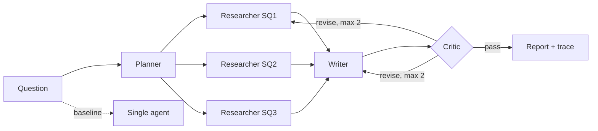

# DeepBrief — multi-agent research & cited reports

One-paragraph summary: DeepBrief takes a research question and produces a structured, cited Markdown report plus a machine-readable JSON trace. A Planner splits the question into 3–5 sub-questions, a Researcher answers each with a plain-Python tool loop (`web_search`, `fetch_page`, `calculator`), a Writer synthesizes only researcher-supplied claims with `[Sx]` citations, and a Critic enforces a bounded (max 2) revision loop. A single-agent baseline with identical tools and budgets enables an honest comparison. All runs are budget-capped, cached, traced with cost/latency, and evaluated for coverage, citation accuracy, and faithfulness.

> Eval questions (`evals/questions.jsonl`) are a first draft and **need human review** before citing results externally.

## Architecture



## Quickstart

```bash
uv sync --extra dev
cp .env.example .env   # add GROQ_API_KEY and optionally TAVILY_API_KEY
uv run pytest -q
uv run ruff check .
# one run (multi-agent with critic)
uv run python -m deepbrief.cli "Compare vector databases for a startup with ~1M documents" --mode multi
# same, but fast: parallel researchers, fewer turns, no critic (for surface-level questions)
uv run python -m deepbrief.cli "LDAC vs LHDC" --mode multi --depth quick
# evals (offline, no keys)
uv run python evals/run_evals.py --offline --configs baseline,multi-no-critic,multi-critic
# UI
uv run python app.py
```

Provider/model selection is env-driven (`LLM_PROVIDER`, `AGENT_MODEL`, `CHEAP_MODEL`, `JUDGE_PROVIDER`, `JUDGE_MODEL`); defaults per provider live in `config.py`. Temperature/seeds configurable; evals pin temperature 0.

## Design decisions & tradeoffs

- **Plain-Python orchestration, no LangChain/LangGraph**: the tool loop and state machine are ~100 lines each, explainable line-by-line in an interview; fewer hidden prompts/retries.
- **Bounded critic (max 2 revisions)**: prevents loops and runaway cost; `revision_cap_reached(2)` is recorded in the trace.
- **Parallel researchers + quick mode**: sub-questions are independent, so researchers run in a thread pool (`RESEARCH_WORKERS=3`; budgets/cache/trace are lock-guarded). `--depth quick` (also a UI toggle, default) halves researcher turns and skips the critic for surface-level questions; `standard` keeps the full treatment.
- **Programmatic citation verification** (`verify.py`): deterministic quote-in-page check (normalized verbatim + fuzzy ≥0.85) complements the LLM entailment judge, which can itself hallucinate.
- **Budgets per run** (LLM calls, tool calls, tokens, wall seconds): abort gracefully with partial result + reason.
- **Thin provider abstraction** over OpenAI-compatible APIs: Groq default, Gemini/OpenAI swappable via env; Mock provider for tests/offline CI.
- **Tavily → DuckDuckGo fallback**, `httpx + trafilatura` extraction, SQLite cache keyed by query/URL, exponential backoff honoring `Retry-After`.
- **Prompt-injection defense**: web content wrapped in `<WEBCONTENT>` + system note, injection patterns stripped, agents instructed never to follow embedded instructions; covered by tests.

## Evaluation methodology

- 25 questions (`evals/questions.jsonl`) across tech comparisons, factual lookups, multi-hop items; each has 3–6 `must_have_facts`.
- Metrics: (a) Coverage — fraction of must-have facts present (LLM judge, strict JSON via Pydantic; offline heuristic in CI); (b) Citation accuracy — share of cited claims supported (programmatic quote check + LLM entailment judge); (c) Faithfulness — supported + 0.5·partial share; (d) cost/latency/tokens/tool calls from traces.
- Judge ideally from a different family than the generator (`JUDGE_PROVIDER`/`JUDGE_MODEL`).
- Ablations: baseline vs multi-no-critic vs multi-critic under equal budgets. `evals/run_evals.py` writes per-question CSV + `SUMMARY_*.md` + 10-claim spot-check CSV into `evals/results/`, pinning models, prompt version, temperature, date, cache on/off.
- Manual spot-check: hand-verify the sampled CSV and record judge–human agreement in `FAILURES.md`.

## Results

Offline eval (`--offline`, mock LLM + stubbed tools, 3-question CI sample, `evals/results/SUMMARY_20260930_212132.md`).
All zeros are the honest measured outcome: the mock generator emits placeholder reports containing none of the
must-have facts, and the mock judge (programmatic quote check) finds no supported citations. This run validates
the harness plumbing (configs, budgets, traces, CSV/summary output), not report quality.

| config | n | coverage | citation_acc | faithfulness | avg_latency_s | avg_cost_usd |
|---|---|---|---|---|---|---|
| baseline | 3 | 0.000 | 0.000 | 0.000 | 0.0 | 0.00000 |
| multi-no-critic | 3 | 0.000 | 0.000 | 0.000 | 0.0 | 0.00000 |
| multi-critic | 3 | 0.000 | 0.000 | 0.000 | 0.0 | 0.00000 |

Live evals with real keys (25 questions × 3 configs): TBD — requires `GROQ_API_KEY` (and ideally a
different-family judge key). No live runs have been performed; no quality claims are made until then.

## Failure analysis

See [evals/FAILURES.md](evals/FAILURES.md) — filled only with failures actually observed in runs.

## Limitations & next steps

- Mock/offline judges are heuristics; live LLM judges + human spot-checks needed for trustworthy numbers.
- Source quality ranking (domain reputation, recency) is minimal; critic flags weak sources but retrieval is naive.
- No claim de-duplication/contradiction resolution across sub-questions beyond the critic pass.
- Next: answer-stability review of all 25 questions, per-domain source allowlists, embedding-based re-ranking, judge–human agreement study, HF Spaces deploy.

## Deploy to Hugging Face Spaces

1. Create a Space (Gradio SDK, Python 3.11).
2. Push this repo (entrypoint `app.py`); set Secrets `GROQ_API_KEY`, optionally `TAVILY_API_KEY`, `LLM_PROVIDER=groq`.
3. The `Dockerfile` is provided for container deploys; Spaces uses `app.py` directly.
4. Demo guards: per-session run cap (5) + hard per-run budgets so one user cannot drain free-tier quota.
